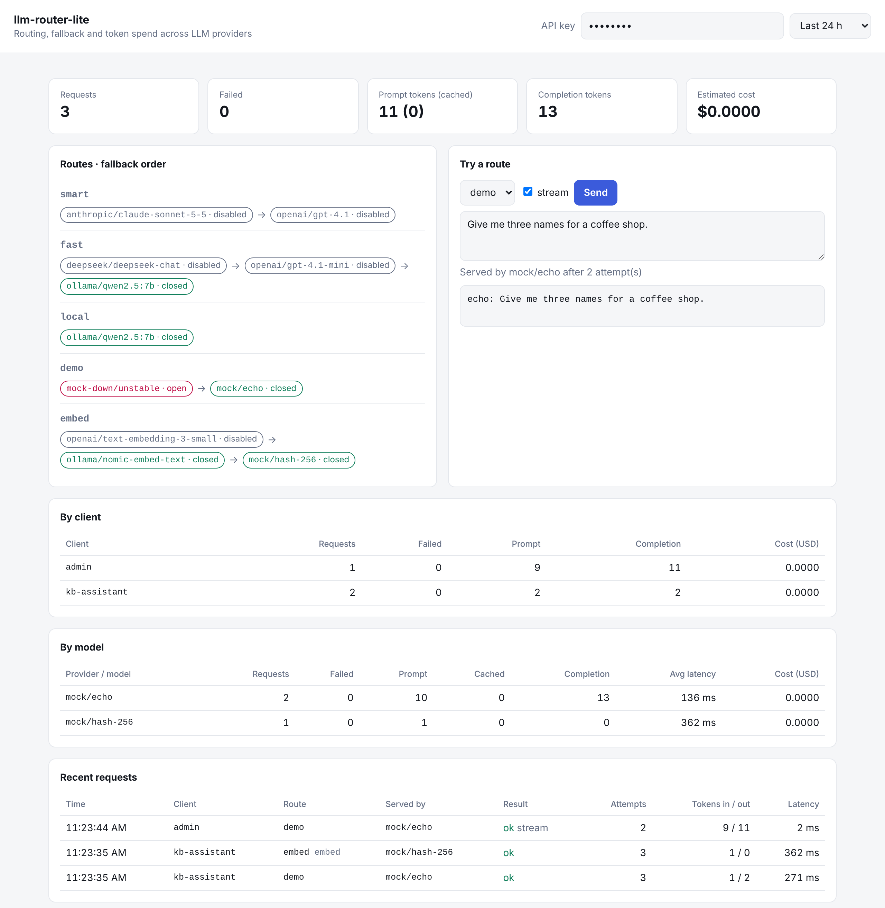
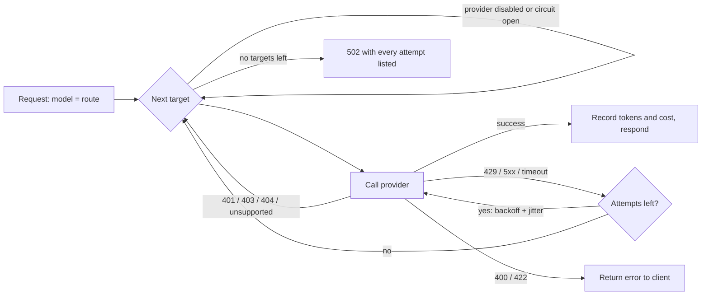

# llm-router-lite

A small self-hosted gateway that sits in front of several LLM providers and gives your apps
**one OpenAI-compatible endpoint**, with routing, retries, fallback, circuit breaking and
token / cost tracking.

Point any OpenAI SDK at it, ask for a route such as `smart` or `fast`, and the gateway decides
which provider actually answers. If Anthropic is overloaded it retries, then falls back to the
next target. If a provider keeps failing it is skipped for a while. Every request is recorded
with its tokens and estimated cost.



## Features

- **OpenAI-compatible API**: `POST /v1/chat/completions` (streaming and non-streaming), `POST /v1/embeddings` and `GET /v1/models`
- **Providers**: Anthropic (translated to and from the Messages API), and any OpenAI-compatible endpoint: OpenAI, DeepSeek, Ollama, vLLM, LM Studio...
- **Routes with fallback**: a route is an ordered list of `provider/model` targets
- **Retries with exponential backoff and jitter** for timeouts, HTTP 429 and 5xx
- **Circuit breaker** per target: after N consecutive failures the target is skipped until a cooldown passes
- **Error classification**: rate limits retry, bad keys or unknown models fall back, and malformed requests are returned to the caller without being retried
- **Streaming fallback**: the first chunk is read before the response starts, so a provider that fails up front is still retried or replaced
- **One key per client**: each customer or app gets its own API key, with optional route allowlist, requests-per-minute limit and monthly budget
- **Token and cost accounting**: input, output and cached tokens per request and per client in SQLite; costs from a price table you control
- **Dashboard** at `/dashboard`: totals, breaker state per target, per-model breakdown, recent requests, and a playground
- **Runs with no API keys**: built-in `mock` providers (one always fails) show retries and fallback in action

## Quick start

```bash
cp .env.example .env            # add the API keys you have; leave the rest empty
docker compose up --build       # http://localhost:8080/dashboard
```

Without Docker (Python 3.10+):

```bash
pip install -e .
cp config.example.yaml config.yaml
ROUTER_API_KEY=change-me llm-router   # serves on :8080
```

Call it like OpenAI:

```python
from openai import OpenAI

client = OpenAI(base_url="http://localhost:8080/v1", api_key="change-me")
reply = client.chat.completions.create(
    model="fast",                                   # a route from config.yaml
    messages=[{"role": "user", "content": "Summarize this ticket in one line: ..."}],
)
print(reply.choices[0].message.content)
```

```bash
curl -s localhost:8080/v1/chat/completions \
  -H "Authorization: Bearer change-me" -H "Content-Type: application/json" \
  -d '{"model": "demo", "messages": [{"role": "user", "content": "hello"}]}' -D - | grep x-router
# x-router-route: demo
# x-router-target: mock/echo
# x-router-attempts: 3      <- the "mock-down" target failed twice, then fell back
```

## Configuration

Everything lives in one YAML file ([`config.example.yaml`](config.example.yaml)). `${VAR}` and
`${VAR:-default}` read environment variables, so secrets stay out of the file. A provider whose
key is not set is shown as disabled and skipped.

```yaml
providers:
  anthropic: { type: anthropic, api_key: "${ANTHROPIC_API_KEY}" }
  deepseek:  { type: openai, base_url: https://api.deepseek.com/v1, api_key: "${DEEPSEEK_API_KEY}" }
  ollama:    { type: openai, base_url: http://localhost:11434/v1 }

routes:
  smart:                          # clients send model: "smart"
    - { provider: anthropic, model: claude-sonnet-5-5 }
    - { provider: deepseek, model: deepseek-chat }
  local:
    - { provider: ollama, model: qwen2.5:7b }

retry:           { max_attempts: 2, base_delay: 0.5, max_delay: 8 }
circuit_breaker: { failure_threshold: 3, cooldown_seconds: 30 }
prices:          # USD per 1M tokens; copy current numbers from each provider
  claude-sonnet-5-5: { input: 3.00, output: 15.00, cached_input: 0.30 }
```

Clients can also bypass routing with `"model": "provider/model"`, for example `"deepseek/deepseek-chat"`.

### Clients

Give each customer or application its own key. Usage and cost are recorded per client, and
limits are enforced before any provider is called:

```yaml
clients:
  acme-support-bot:
    api_key: ${ACME_KEY}
    routes: [fast, embed]          # optional allowlist; omit for every route
    requests_per_minute: 60        # optional → HTTP 429 + Retry-After
    monthly_budget_usd: 30         # optional → HTTP 429 "budget_exceeded" (needs prices)
```

| Key | Can call | Sees |
|---|---|---|
| Admin (`server.api_keys`) | every route | all usage (`/v1/usage?client=` to filter), `/v1/status` |
| Client | its allowed routes | only its own usage and budget |

## How a request is routed



| Upstream result | What the router does |
|---|---|
| Timeout, connection error, HTTP 429, 5xx | Retry the same target with backoff, then fall back |
| HTTP 401 / 403 / 404, or a feature the adapter cannot translate | Fall back immediately (no retry) |
| HTTP 400 / 413 / 422 | Return the error: the request itself is wrong, another provider would reject it too |

Every successful response carries `x-router-route`, `x-router-target` and `x-router-attempts` headers.

**Streaming**: the gateway reads the first chunk before sending headers, so failures that happen up
front (rate limits, overloads, bad keys) still fall back. Once text has reached the client it cannot
switch providers; a later failure is sent as a final `{"error": ...}` chunk.

**Anthropic adapter**: system prompts, text and image content, `temperature`, `top_p`, `stop`,
`max_tokens`, streaming and prompt-cache token counts are translated. Tool calling is not; requests
with `tools` skip Anthropic targets and fall back to an OpenAI-compatible one.

## API

| Endpoint | Description |
|---|---|
| `POST /v1/chat/completions` | OpenAI chat completions, with `stream: true` support |
| `POST /v1/embeddings` | OpenAI embeddings, routed the same way (Anthropic targets are skipped) |
| `GET /v1/models` | The configured routes |
| `GET /v1/usage?hours=24` | Totals, breakdown by model and by client, the 20 most recent requests |
| `GET /v1/status` | Admin only: providers, breaker state per target, clients and their limits |
| `GET /dashboard` | Web dashboard |
| `GET /healthz` | Liveness check (no auth) |

## Project layout

```
src/llm_router/
  app.py            HTTP layer (Starlette): validation, limits, SSE
  auth.py           admin and client keys, rate limiter, budget window
  router.py         route resolution, retries, fallback, streaming relay, accounting
  breaker.py        circuit breaker
  usage.py          SQLite usage store and cost calculation
  config.py         YAML + ${ENV} loading, validated with pydantic
  providers/        openai_compat.py, anthropic.py, mock.py
  static/           dashboard.html (no build step, no external assets)
tests/              unit and HTTP tests; upstreams are faked with httpx.MockTransport
```

Built on [Starlette](https://www.starlette.io/) (the toolkit under FastAPI) and httpx to keep the
dependency list short.

## Development

```bash
pip install -e ".[dev]"
pytest -q
ruff check src tests && ruff format --check src tests
```

CI runs the tests on Python 3.10 and 3.12, builds the Docker image and smoke-tests it.

## Limitations and next steps

- One process: breaker state and the SQLite store are local. For several replicas, move them to Redis/Postgres.
- Rate-limit counters live in memory and reset on restart; budgets are read from the usage database.
- Tool calling is passed through only to OpenAI-compatible providers.

## License

[MIT](LICENSE) © 2026 Yihan Qiu

---

Built by [Han (Yihan Qiu)](https://hanxmone-ai.github.io/) · AI full-stack engineer · [GitHub](https://github.com/hanxmone-ai) · [Portfolio](https://hanxmone-ai.github.io/)
